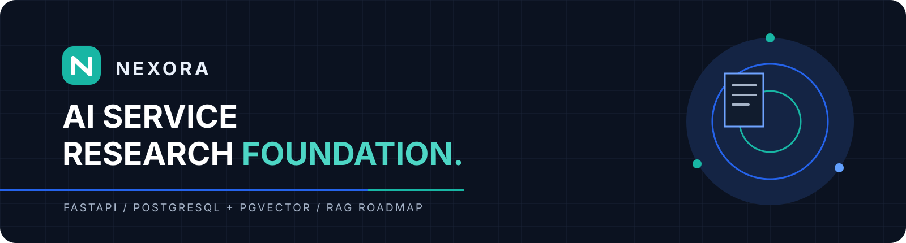

# Nexora AI



  

The AI service for Nexora. FastAPI provides a health endpoint and internal Swagger routes for synchronous document ingestion, Board-scoped search, and optional grounded answers with verified citations. Retrieval combines dense and BM25 candidates, RRF fusion, and cross-encoder reranking. Express remains the public API and owns user authentication and Board authorization.

## Repository map

```text
src/main.py                       FastAPI entrypoint and model warmup
src/api/                          Service key, HTTP routes and payloads
src/documents/                    Shared document models and lifecycle states
src/ingestion/                    Extract, clean, chunk, embed and persist
src/embedding/                    BGE-M3 embeddings for documents and queries
src/retrieval/                    Board-scoped dense/BM25, fusion and reranking flow
src/reranking/                    Cross-encoder model and shortlist selection
src/answering/                    Grounding, system prompt and citations
src/providers/deepseek/           DeepSeek HTTP transport and answer client
src/persistence/                  PostgreSQL connections, probes, reads and writes
scripts/db/                       Connectivity check and confirmed dev schema bootstrap
scripts/ingestion/                Ingest, inspect, preview and launch local Tika
evaluation/                     retrieval and answer evaluation tools
tests/ingestion/                extraction, cleaning, persistence, workflow tests
tests/ingestion/chunking/        chunker and tokenizer tests
tests/structure/                CLI entrypoint checks
docs/architecture/              architecture notes
docs/guides/ingestion/          ingestion guides
docs/plans/                     implementation plans and design specs
docs/refactor/                  repository organization plans
```

## Run the Swagger demo

Set `AI_SERVICE_API_KEY` and `DEEPSEEK_API_KEY` in `.env`, then run:

```powershell
docker compose up -d --build --wait --wait-timeout 900
```

Once the images are built, use `docker compose up -d --no-build --pull never --wait --wait-timeout 900`
to start with the local images. Rebuild after changing the API source or its dependencies.

Open [Swagger](http://127.0.0.1:8000/docs) and follow the
[Vietnamese demo guide](docs/guides/api/swagger-demo.md). Compose runs the API,
Tika and a dedicated PostgreSQL/pgvector database. It keeps model weights,
uploads and database data in Docker volumes.

## Run the health endpoint with local Python

Install uv and run these commands from the AI repository root. uv reads
`.python-version` for Python 3.12 and installs the packages in `uv.lock`.
The health endpoint does not require PostgreSQL or environment variables.

```powershell
uv python install
uv sync --locked
uv run --locked uvicorn src.main:app --host 127.0.0.1 --port 8000 --reload
```

Open `http://127.0.0.1:8000/health`. The authenticated upload and search routes also appear in `/docs` when `AI_SERVICE_API_KEY` is configured.

## Run the development checks

Run Ruff and the offline test suite locally. The offline test suite can run
with an empty Hugging Face cache.

```powershell
uv run --locked ruff check .
$env:HF_HUB_OFFLINE = "1"
$env:TRANSFORMERS_OFFLINE = "1"
uv run --locked pytest -q -m "not integration and not real_model and not database"
```

Run tests marked `integration`, `real_model`, or `database` separately. The
[isolated integration guide](docs/guides/testing.md) explains how to connect
to PostgreSQL and Tika and initialize a disposable test schema.

## Check PostgreSQL and pgvector

Run the database check with local settings:

```powershell
uv run --locked --env-file .env python -m scripts.db.check_db
```

On success, the command prints `PostgreSQL/pgvector check passed (vector <version>).` It only reads the extension version and runs a vector operation. The backend repository owns extension creation and all Prisma migrations.

## Search documents (standalone Python)

`search_documents()` runs Board-scoped hybrid retrieval, RRF fusion and
cross-encoder reranking. Export `DATABASE_URL` or start Python with
`uv run --locked --env-file .env python`. Pass a Board ID the caller is
already authorized to access.

```python
from src.retrieval import search_documents

results = search_documents(
    "What is the document retention policy?",
    board_id="11111111-1111-4111-8111-111111111111",
    top_k=5,
)

for chunk in results.chunks:
    print(chunk.file_name, chunk.page_number, chunk.content)
```

Each returned chunk includes document/chunk IDs, source locations, and RRF/reranker scores. The public result intentionally omits the internal storage key.

## Service boundary

The [RAG architecture](docs/architecture/rag-architecture.md) records the responsibilities of each service. The Swagger routes are an internal demo boundary: Express must authenticate callers and authorize Board access before passing a Board ID to AI. Production storage and database migrations remain owned by the backend.
